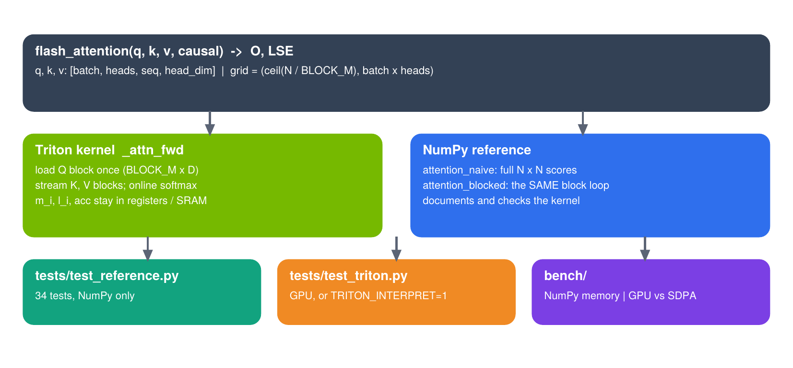

# triton-flash-attention

[](https://github.com/tahsin-ts/triton-flash-attenti0n/actions/workflows/ci.yml)

A FlashAttention forward kernel written in [Triton](https://triton-lang.org), plus a NumPy
implementation of the same block loop that documents and checks it.

Attention normally builds an N x N score matrix in GPU memory. This kernel never does: each program
loads a block of queries once, streams keys and values through on-chip memory in blocks, and uses the
**online softmax** (running max, running sum, rescaled accumulator) to produce exact results.
Memory grows with N instead of N^2.



## Quick start

```bash
pip install numpy pytest
make test           # the algorithm vs naive attention (NumPy, any machine)
make bench-cpu      # peak memory and time, naive vs blocked (NumPy)

pip install torch triton
make test-triton    # the Triton kernel vs PyTorch (GPU, or Triton's CPU interpreter without one)
make bench-gpu      # GPU: vs naive PyTorch and torch SDPA, ms / TFLOP/s / memory
```

```python
from flash_attn import flash_attention
o = flash_attention(q, k, v, causal=True)          # q, k, v: [batch, heads, seq, head_dim], fp16/bf16/fp32
o, lse = flash_attention(q, k, v, return_lse=True) # log-sum-exp per row, what a backward pass needs
```

## Measured on a CPU (NumPy, 1 head, d=64, float32)

| N | naive peak MiB | blocked peak MiB |
|---|---|---|
| 1024 | 8.3 | 0.5 |
| 2048 | 32.5 | 0.8 |
| 4096 | 129.0 | 1.3 |
| 8192 | 514.0 | 2.3 |

Naive memory grows 4x each time N doubles; blocked memory grows linearly. Reproduce with `make bench-cpu`.
GPU speed: run `make bench-gpu` on your GPU.

## Layout

```
flash_attn/triton_fwd.py   the Triton kernel and launcher
flash_attn/reference.py    naive attention and the blocked algorithm in NumPy
flash_attn/iomodel.py      HBM-traffic model: standard vs flash
tests/                     NumPy tests (exactness, causal masks, LSE, memory) and Triton tests
bench/                     CPU (NumPy) and GPU benchmarks
```

## Limits

Forward pass only; head_dim 16/32/64/128; q, k, v of the same shape (no grouped-query attention).

## License

MIT
